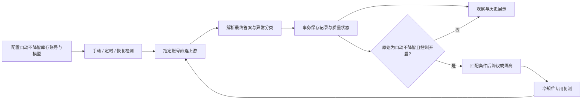

# OpenAI / Codex 账号质量检测与调度控制：整体需求设计

版本：v1.3。日期：2026-10-28。状态：**本地核心实现已接通，自动检测和调度控制保持关闭；端到端与多实例验收进行中**。监控/配置为两独立页，范围限定为现有自动不降智分组。当前实现与未验证项见 [verification.md](./verification.md#11-本地实现与验证-2026-10-28)。

代码基线：`96f8b5034`（`v0.2.18.1`）。当前分支：`feature/openai-account-quality-control`。

## 阅读顺序

| 文档 | 内容 | 主要读者 |
| --- | --- | --- |
| [requirements.md](./requirements.md) | 完整业务需求、范围、检测与判分、状态、控制规则、页面、默认值、异常和待定事项 | 产品/运营/需求确认 |
| [implementation-guide.md](./implementation-guide.md) | 两页/API/开源组件接线、配置生效矩阵、预算与窗口校验、完整隔离恢复示例、实施出口 | 开发/联调/整体评审 |
| [ui-design.md](./ui-design.md) | 新增两个独立页面、导航/配置线框、自动不降智范围与共享账号边界 | 产品/前端/运营 |
| [source-reuse.md](./source-reuse.md) | 已搬入的开源源码、固定版本/许可、逐能力复用映射、已移植代码与未接通部分 | 开发/代码评审 |
| [design.md](./design.md) | 架构、现有代码接入、数据字典、并发、缓存、请求路径、迁移与回退 | 开发/技术评审 |
| [api-contract.md](./api-contract.md) | 拟新增 API、参数、示例、幂等、分页、错误及权限边界 | 前后端联调 |
| [spec.md](./specs/account-quality-control/spec.md) | 编号化需求、场景验收、跨模块回归与需求追踪 | 测试/验收 |
| [tasks.md](./tasks.md) | 分阶段工作拆解、依赖与交付标准 | 开发执行 |
| [verification.md](./verification.md) | 已核对的证据、设计检查结果与尚未执行的功能验证 | 评审/交接 |
| [proposal.md](./proposal.md) | 变更动机和影响面摘要 | 快速浏览 |

## 已确认的业务方向

1. 检测对象为参与现有“自动不降智分组”的 OpenAI / Codex 上游账号，逐账号执行；本需求不对普通固定组启用检测/控制。
2. 检测结果用于降低有效调度优先级、连续错误后隔离、复测通过后恢复。
3. 用户已指示按 v1.3 设计开始本地实现。自动检测和全局/策略控制默认关闭，生产迁移、部署、真实模型调用和启用不包含在本次本地实现范围。
4. 新增“检测监控”和“检测配置”两个独立后台页面，账号页保留辅助入口。自动不降智模式的范围边界为用户本轮明确要求。
5. 用户要求复用开源项目已有代码；已将原版搬入 third_party/manxue-ai，并移植监控时间线/统计计算。页面采用其已有监控/配置结构进行 Vue 适配，不从零重复设计相同能力。

## 推荐方案概览

在系统内对自动不降智库存的指定账号发送有确定答案的测试题，独立记录回答质量；先以观察方式验证，再按策略作用于原始 API Key 为 openai_auto_cheapest 且匹配模型和条件的请求。普通固定组/独立 composite 不应用本质量状态。现有网络健康、限流、人工禁用、计费与鹈鹕预览继续各自表达原有含义。

建议首期使用语义明确、服务器可独立判分的糖果题。现站 manxue.ai 的鹈鹕源码分类器未确认开源；现有鹈鹕生成预览不能直接当作质量判定。

已搬入的开源版包含监控页、配置页、糖果检测、SVG 校验和多帧视觉审核；具体复用边界见 source-reuse。正式管理 API、两独立 Vue 页面、探测队列和调度质量门已接通；`qualityMonitor.ts` 保留为完整集合的统计对照，生产页面从服务端全量聚合读取数据。

v1.3补齐：全量概览/24H聚合接口、最多288桶及分页下钻、全局默认与策略实值的生效规则、配置变更/在途任务处理、预算不足导致阈值证据难以累计的预览，以及三错隔离/冷却两次通过恢复规则。代码已按该设计落地，实际验证和未验证边界见 verification。建议先阅读集成指南，再按具体领域查阅其余文档。

建议默认：自动检测和调度控制关闭；普通检测 30 分钟一次；有效答案连续错误 3 次隔离；最短冷却 30 分钟；冷却后每 10 分钟复测，连续 2 次有效通过恢复。上述参数可配置。

## 本稿特别明确的边界

- 冷却到期不自动恢复，持续无法证明恢复时隔离可能超过 30 分钟。
- `incorrect`、`unknown`、`error` 分开，不能用网络故障证明“降智”。
- 只检测 low 不等于能控制所有 effort；精确匹配是首期建议，模型级扩大影响属于待定选项。
- 全部候选被质量规则拒绝，和质量存储本身故障，使用不同错误原因。
- 原始 `Priority` 不被自动改写；检测请求不经过公网调度器，也不计入用户用量账单。
- 同一账号在自动不降智内被质量隔离时，普通固定组仍按原逻辑使用；内部切组/共享池不能让自动模式绕过质量门。
- 上游绑定的 response ID 不能交给另一账号；不能中断已经输出内容的请求来拼接其他账号的结果。
- 权限沿用项目实际管理员角色 `IsAdmin()`；首期不开放给受限管理 API Key，不引入不存在的“超级管理员”角色。
- 方案完整不等于生产能力已经验证。参考题答案已独立枚举，功能、性能和真实模型效果仍需实现后验收。

## 评审重点

[需求第 18 节](./requirements.md#18-待评审决策清单) 集中列出 D01–D09 推荐与替代方案。重点是控制是否精确到 effort/档位/传输、全隔离与存储故障是否拒绝请求，以及长期复测受阻时是否保持隔离。这些会直接影响可用性，应和题目、预算一起评审；当前不要求先回答才能阅读完整方案。
