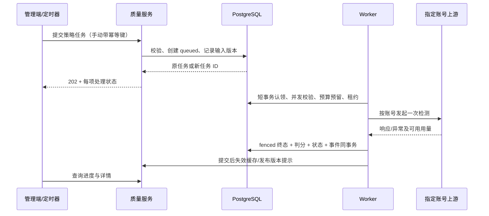

# 技术设计说明书

版本：v1.3；日期：2026-10-28；状态：实现依据。文中设计已用于本地代码实现；接口与页面实现情况、验证边界见 [verification.md](./verification.md#11-本地实现与验证-2026-10-28)。控制范围限定为现有自动不降智模式，包含两独立页面、监控聚合及配置生效规则。

基线：96f8b5034（v0.2.18.1）。业务规则以 [requirements.md](./requirements.md) 为准，接口以 [api-contract.md](./api-contract.md) 为准，验收见 [spec.md](./specs/account-quality-control/spec.md)。

v1.2 补充：原版开源源码已导入 third_party/manxue-ai/upstream，监控数据模块 qualityMonitor.ts 已移植并测试。下述 Go/数据库/API/页面接线仍未实现；已存在文件与复用路径见 [source-reuse.md](./source-reuse.md)。Python 文件仅是保留的原始源码，不作为新运行服务接入。

## 1. 架构取舍

推荐在现有 Go 后端内增加独立质量模块，复用账号鉴权、模型映射、代理、HTTP/WS 客户端、配置、数据库和管理 UI。首期不新增 Python/Chromium 服务，不调用第三方判分站，不将质量状态塞进账号限流/错误字段。

监控/配置页面以已搬入的开源 HTML/JS/CSS 为来源适配，已有时间线/历史/节点设置不重复发明；保持本站 Vue、鉴权和组件规范。qualityMonitor.ts 已将 renderTimeline/renderState 的数据计算与 DOM/网络解耦；仅在完整且预先过滤代次的数据集上直接使用。正式24H页面使用同口径的服务端聚合，不能用一页历史算全量；统计与原版分母差异在文件头和来源文档说明。

| 备选 | 优点 | 代价/限制 | 结论 |
| --- | --- | --- | --- |
| 直接接 manxue.ai 完整检测 API | 接口已公开，可获得现站分类结果 | 提交上游凭据；外部可用性与版本依赖；不能直接绑定内部 OAuth/影子路由 | 不作为首期主链路 |
| 部署相关 Python 开源项目 | 可自托管，现有视觉审核代码可参考 | 不等于现站分类器；需要浏览器和第二次视觉调用 | 留作后续实验 |
| Go 内定向检测与本地确定性判分 | 账号定位明确，无第三方凭据传输，容易衔接现有调度 | 需要独立状态、任务、管理端和请求路径改造 | 推荐 |

## 2. 现有能力核对与影响文件

| 现有文件 | 已存在能力 | 拟议变化 |
| --- | --- | --- |
| backend/internal/service/account_test_service.go | RunPromptBackground；OpenAI OAuth/API Key 路由；自定义 Prompt；SSE 文本与可选 Token；OpenAI 测试回报可用性结果 | 为质量调用增加显式选项，隔离普通测试结果回报与自动恢复；旧入口行为兼容 |
| backend/internal/service/pelican_test_service.go | 按账号生成，previewable/unpreviewable/failed，HTML 提取与脱敏 | 保持含义；质量页面可链接已有预览，但不将其用于自动判分 |
| backend/internal/service/scheduled_test_runner_service.go | 定时调用普通测试；成功时可恢复错误/限流 | 不复用其成功标识解除质量隔离；独立质量 runner |
| backend/internal/service/openai_account_scheduler.go | 新调度入口、ReasoningEffort、候选兼容、previous_response/session、池来源 | 统一获取质量上下文、匹配、降权和隔离；增加有效服务档位传递 |
| backend/internal/service/openai_gateway_scheduling.go | legacy、跨来源健康阶段、最优惠来源选择 | 仅在原始 auto 范围复用质量门，保持既有全来源健康阶段和权限 |
| backend/internal/service/openai_scheduler_policy.go | 候选资格、效用、后备池 | 新增独立质量维度，不冒充网络 health 或仅修改旧 FinalScore |
| backend/internal/service/openai_ws_client.go、openai_ws_forwarder_v2.go | WS 客户端、连接池与转发 | 复用账号认证/传输能力构建隔离的 WS 探测，不复用真实用户 response/session |
| backend/internal/handler/openai_gateway_handler.go | acquireOpenAIAccountSlot、准入、WS 多 turn 检查 | 发送上游前终检；后续 turn 复查；失败释放资源且不提前绑定 |
| backend/internal/handler/admin/idempotency_helper.go | executeAdminIdempotent 系列与管理员作用域 | 复用异步任务提交幂等；存储失败拒绝创建新任务 |
| backend/internal/pkg/response/response.go | Success/Accepted/ErrorWithDetails/Paginated | 管理端使用现有响应 envelope，异步 202 机制已存在 |
| backend/internal/server/middleware/admin_auth.go、internal/pkg/adminaccess/catalog.go | IsAdmin 和受限管理 API Key 路由准入 | 新路由使用原管理员鉴权，首期不在受限 Key 目录增加授权 |
| backend/internal/repository/pelican_test_repo.go | database/sql、参数化 SQL、任务条件更新 | 参考其本地仓储风格，不能复制不适合集群的任务/清理语义 |
| backend/internal/service/wire.go、internal/handler/wire.go、cmd/server/wire.go | 依赖注入与 Start/Stop 生命周期 | 登记拟新增仓储、service、runner 和 handler；由生成器更新 wire_gen |
| frontend/src/views/admin/AccountsView.vue 及 account 组件 | 批量操作、定时测试/鹈鹕弹窗、账号摘要 | 新增独立质量组件和 API 模块，避免继续堆大段页面内联逻辑 |
| frontend/src/views/user/keyGroupOptions.ts、backend/internal/service/openai_auto_cheapest_group_service.go | 自动不降智选项 openai_auto_cheapest、CandidateGroups 资格/倍率解析 | 复用真实模式和来源规则，不按中文分组名匹配 |
| backend/internal/service/openai_auto_cheapest_group_context.go | 自动请求上下文、真实账号来源与失败来源后置 | 准入时固定原始模式，内部 effective GroupID 改变仍保留质量范围 |
| frontend/src/router/index.ts、frontend/src/components/layout/AppSidebar.vue | 后台路由、管理员导航与分级菜单 | 登记拟新增的监控/配置两页和导航权限 |

当前调度请求已经携带 ReasoningEffort，但没有同等的 ServiceTier 字段。完整精确匹配必须沿真实解析/映射链路传递有效档位；不能只把文档字段加到数据库。

现有幂等 JSON helper 固定 response.Success（200），coordinator=nil 时直接执行，且默认 ObserveOnly 可放过缺失键。质量路由需要强制键/存储检查、事务幂等适配和 Accepted/Created 状态码处理（见 §6.4），不能把“已复用 helper”当作天然满足 202 与失败拒绝的证明。既有接口行为不做无关更改。

## 3. 拟新增模块

- service/account_quality_types.go：领域对象、枚举、范围键与纯业务规则。
- service/account_quality_benchmark.go：内置题、严格 JSON 判分与版本。
- service/account_quality_service.go：策略、任务、手动解除、事件与预算编排。
- service/account_quality_runner.go：到期扫描、任务认领、恢复探测、取消与租约。
- service/account_quality_probe.go：按账号执行及 HTTP/WS 适配；复用现有客户端而不是复制完整网关。
- service/account_quality_scheduling.go：有效请求上下文、范围匹配、双池排序与隔离准入。
- service/account_quality_scope.go：自动不降智模式准入、参与来源/账号库存与资格失效；文件名为拟议。
- repository/account_quality_repo.go：参数化 SQL 仓储与事务边界。
- handler/admin/account_quality_handler.go：参数校验、权限、幂等和响应。
- frontend/src/api/admin/accountQuality.ts 与独立配置、批量运行、详情/历史组件。
- frontend/src/views/admin/OpenAIQualityView.vue、OpenAIQualitySettingsView.vue：分别承载监控与配置；前端页面路由和布局见 [ui-design.md](./ui-design.md)。

上述文件名是实施建议，不是已经存在的工具类/公共方法。正式编码前需独立搜索冲突与直接调用关系。

## 4. 请求条件和证据身份

检测配置包含 model_id、protocol、transport、reasoning_effort、service_tier、benchmark_id/version、scorer_version。服务端解析并记录 routing_model、upstream_model 和 effective 参数。

入站公开模型 → 分组模型路由 → 账号模型 mapping → OAuth/上游模型规范化的结果必须与真实转发一致。质量匹配在账号可确定之后，用同一份只读有效请求上下文判断；不能让检测与真实请求各自维护一套映射表。

请求范围使用确定序列化后计算的 SHA-256 control_scope_hash，输入包含逻辑账号、有效凭据身份标识、上游地址/代理/路由配置指纹、实际模型、协议、传输、effort、档位。证据身份 scope_hash 在此基础上加入题目与评分版本。哈希不包含原始 Key/Token，不持久化秘密派生值。同一请求范围首期只允许一个活动策略，避免两个题目版本给出冲突控制。

正常 OAuth Token 刷新不改变身份；实际账号身份或其他路由条件改变必须改变指纹。无法可靠判断身份变化的路由不得悄悄复用旧证据，标记 identity_unverified 并重新检测。

既有策略记录的是账号接收的模型 ID；公开模型名只作上下文展示。不同公开别名仅在明确解析为同一已配置账号输入模型及相同有效条件时匹配，不泛化到整个模型 family。

### 4.1 自动不降智限定范围

原始 API Key 的 UsesOpenAIAutoCheapestGroup() 为唯一业务模式来源。鉴权/handler 初始化时生成不可由公网字段覆盖的 quality_scope= openai_auto_cheapest 上下文，普通固定组/独立 composite 请求直接退出本模块，不读质量快照、不降权、不隔离。自动请求克隆 effectiveKey、切分组/自建池、重试及 WS 后续 turn 时必须传递该上下文，不能用此时非空 GroupID 误判成普通分组。

检测库存按活跃 OpenAI 普通来源组、AllowAutoCheapestScheduling 及其有效 self_hosted_pool 引用计算，复用当前来源资格规则，不以分组名字判断。此库存是管理员配置集合；实际用户/密钥授权、倍率上限仍以 CandidateGroups 在请求时解析为准。手动、定时、恢复都校验库存，移出全部有效来源后暂停该策略、取消未发出任务并推进代次；重新纳入后从 untested 建立新证据。

创建策略另要求 source_group_id（有效业务来源组上下文），服务端验证其能通过直接账号或被引用号池到达该账号，再计算模型/effort/tier 等实际发送条件。source_group_id 不是自建池 ID；物理池来源单独记录。若多个组产生相同账号/有效路由与条件，前端引导复用同一活动策略，返回 compatible_source_group_ids；创建接口仍以范围冲突拒绝重复，不静默覆盖旧规则，不能按每用户/每 Key 重复检测。组配置影响有效路由时纳入条件指纹并按范围失效处理。

质量状态的执行域固定为 auto 模式，不写 Account.status/schedulable/全局健康；同一账号仍可按原逻辑服务普通固定组。来源组移除导致上下文失效但账号仍可由另一自动来源使用时，显式选择新的有效上下文并重新校验；不得在旧上下文中继续发检测。

## 5. 数据设计

### 5.1 规模与表数取舍

最初两表草案不足以完整承载可追踪状态事件与集群预算。本稿推荐四张独立表：策略/当前状态、执行记录、状态事件、每日预算计数。任务租约和并发槽使用执行记录承载，不再增加运行时槽表。

均使用项目现有 PostgreSQL 与 database/sql。字段名/类型参考现有账号任务、调度健康和审计表，迁移编号在实现时按最大已用编号分配。本文只定义字段，不提供已执行 DDL。

### 5.2 account_quality_policies

| 字段组 | 字段与建议类型 | 约束/用途 |
| --- | --- | --- |
| 主键/关联 | id BIGSERIAL；account_id/source_group_id BIGINT；account_name_snapshot VARCHAR(255) | source_group_id 为有效业务上下文；账号删除后归档策略但保留脱敏归属；不级联删历史 |
| 执行域 | routing_mode VARCHAR(32) | 首期固定 openai_auto_cheapest，只读；资格/上下文失效时暂停，不扩大到 fixed |
| 参与资格 | eligibility_status VARCHAR(32)；eligibility_checked_at TIMESTAMPTZ | eligible/out_of_scope/source_context_invalid；来源/成员变更后重新核验，停用与重新参与推进代次；运行前仍重新校验 |
| 检测配置 | model_id VARCHAR(255)；protocol/transport VARCHAR(32)；reasoning_effort/service_tier VARCHAR(32) | 空白 trim，哨兵 upstream_default 表示省略，不能当真实上游字段发送 |
| 版本 | benchmark_id/version/scorer_version VARCHAR(64)；control_scope_hash/scope_hash VARCHAR(64)；revision BIGINT | revision 为乐观锁；两个 hash 只由服务端生成 |
| 控制代次 | policy_control_epoch BIGINT；state_global_control_epoch BIGINT；state_policy_control_epoch BIGINT | 开关、解除、条件变更防止旧任务污染新控制周期 |
| 执行规则 | auto_check_enabled/control_enabled BOOLEAN；interval_seconds/jitter_seconds/timeout_seconds/max_output_tokens/daily_call_limit INTEGER | 默认两个开关均 false；字段范围见需求字典 |
| 质量规则 | failure_threshold/recovery_threshold/cooldown_seconds/recovery_interval_seconds/evidence_window_seconds INTEGER | 证据/计数窗口可独立表达但首期用同一配置 |
| 状态 | state VARCHAR(24)；failure_streak/recovery_streak INTEGER；failure_window_started_at/recovery_window_started_at/last_valid_at TIMESTAMPTZ | 仅当前 scope 和控制代次有效，计数非负 |
| 隔离 | quarantined_at/cooldown_until TIMESTAMPTZ；last_reason VARCHAR(255) | 冷却时间不是解除时间 |
| 检测快照 | last_run_id BIGINT；last_verdict VARCHAR(24)；last_checked_at/next_run_at/evidence_expires_at TIMESTAMPTZ | 缺有效结果时证据时间为空 |
| 生命周期 | created_by/updated_by BIGINT；created_at/updated_at/archived_at TIMESTAMPTZ | 归档保留唯一范围语义，恢复需显式动作 |

索引：活动策略唯一 (account_id, control_scope_hash)；到期索引 (next_run_at) WHERE archived_at IS NULL AND auto_check_enabled；账号/状态查询索引；updated_at/id 增量同步索引。检测条件不支持直接 PUT 改写，需新建替代策略并归档旧策略；服务端支持在批量创建事务内显式指定 replaces_policy_id，避免替换时留下控制空档。账号外部配置变化导致指纹漂移时，原策略 revision/代次递增、旧范围失效并重建证据，遇到范围冲突必须停止控制并提示管理员处理，不能任选一条覆盖。

### 5.3 account_quality_test_runs

| 字段组 | 字段与建议类型 | 约束/用途 |
| --- | --- | --- |
| 标识 | id BIGSERIAL；batch_id VARCHAR(36)；policy_id/account_id BIGINT | 单次手动或扫描形成 batch，记录可独立查询 |
| 输入快照 | policy_revision、global/policy_control_epoch BIGINT；scope_hash VARCHAR(64)；condition_snapshot JSONB | 包含 routing_mode、有效来源组/物理账号池、非敏感条件、规范化模型、凭据所有者账号 ID/身份版本、路由指纹与题目版本 |
| 触发 | trigger_source VARCHAR(24)；actor_user_id BIGINT NULL；scheduled_slot TIMESTAMPTZ NULL | manual/scheduled/recovery；自动任务以持久化到期时间作为周期槽，系统任务 actor 为空 |
| 运行 | status VARCHAR(24)；verdict VARCHAR(24) NULL；reason_code VARCHAR(64)；reason TEXT | queued/running/completed/cancelled/interrupted/skipped；verdict 在可判定后写入 |
| 租约 | lease_owner/lease_token VARCHAR(64)；lease_expires_at/heartbeat_at TIMESTAMPTZ；cancel_requested BOOLEAN | 过期 worker 完成必须被 fencing 拒绝 |
| 上游阶段 | upstream_dispatched_at TIMESTAMPTZ；upstream_status_code INTEGER NULL；upstream_response_id VARCHAR(255) NULL | 受理不确定也按已尝试计额度；不暴露内部 response ID 给业务用户 |
| 判分 | final_answer BIGINT NULL；expected_answer BIGINT；state_applied BOOLEAN；state_skip_reason VARCHAR(64) | 显示该结果是否影响当前聚合 |
| 正文 | response_text TEXT；response_truncated BOOLEAN；response_expires_at TIMESTAMPTZ | 64 KiB 上限；到期清空正文但保留元数据 |
| 用量 | input_tokens/output_tokens/total_tokens BIGINT NULL；estimated_cost_usd NUMERIC(18,8) NULL；pricing_snapshot JSONB NULL | 缺失与零区分；成本为估算 |
| 时间 | queued_at/started_at/finished_at/queue_expires_at TIMESTAMPTZ；latency_ms BIGINT NULL | 时间戳由数据库与单调计时各司其职 |
| 预算 | budget_date DATE；budget_reserved/budget_consumed BOOLEAN | 用于名额释放幂等；不能仅依赖内存标记 |

索引：策略历史 (policy_id,id DESC)；账号历史 (account_id,id DESC)；批次；排队到期；状态/租约到期；正文清理时间。活动任务部分唯一索引 (policy_id) WHERE status IN (queued,running)；运行中唯一索引 (account_id) WHERE status=running；自动周期唯一索引 (policy_id,scheduled_slot) WHERE scheduled_slot IS NOT NULL。手动任务 scheduled_slot 为空。

账号有多个策略时允许排队，但每次最多一个运行中任务；唯一约束兜底，不能靠 Go 进程锁保证集群正确性。

### 5.4 account_quality_events

id、policy_id/account_id、run_id NULL、event_type VARCHAR(64)、old_state/new_state VARCHAR(24)、reason_code、actor_user_id NULL、控制代次、revision、非敏感 metadata JSONB、created_at。

用于质量状态、控制开关、人工解除、归档和运行异常事件。与状态变化同事务提交。全局设置与管理员操作另复用已有 AuditLogService，但不依赖其异步写入替代业务状态事件。

索引：(policy_id,id DESC)、(account_id,id DESC)、(created_at)。保留期限见需求，不保存完整凭据、上游响应头或业务 Prompt。

账号关联不可采用级联删除历史；策略归档不物理删除。last_run_id 与 events.run_id 若使用外键，清理记录时须 ON DELETE SET NULL，避免保留期清理失败；当前隔离状态的紧凑快照保留在策略，不依赖过期正文维持控制。正文和事件按各自期限清理，界面能区分“历史已清理”和“从未检测”。

### 5.5 account_quality_daily_budgets

budget_date DATE、scope_type VARCHAR(16)、scope_id BIGINT、reserved_calls/consumed_calls INTEGER、updated_at TIMESTAMPTZ；唯一 (budget_date,scope_type,scope_id)。scope_type=global 时 scope_id=0，policy 时为 policy_id。

事务中按固定顺序锁全局再锁策略计数，满足两个上限才预留。已发出调用转 consumed；未发出的取消按 run_id 标记防止重复退还。历史记录保留至少覆盖结果保留期；过期清理不影响当天预算。

### 5.6 全局设置

建议在现有 settings 中增加一个 JSON 配置键 openai_account_quality（拟新增）：revision、automation_enabled、control_enabled、control_epoch、global_concurrency、queue_limit、queue_timeout_seconds、global_daily_call_limit、default_policy_daily_call_limit、raw_retention_days、metadata_retention_days、store_failure_policy。预算时区读取现有实例时区配置，不新增第二份可单独漂移的时区。

现有 SettingService 负责校验/缓存。控制从 false→true 时递增 control_epoch；旧快照的 state_global_control_epoch 不匹配就不能追溯用于真实控制。全局开关不修改数千条账号 Priority，也不覆盖其他配置。

default_policy_daily_call_limit 只在创建时复制，其他策略规则默认值来自代码版本；不采用动态继承，不增加模板表。全局预算/并发/队列仍是全体任务的硬约束。配置变更矩阵见 [集成指南 §3](./implementation-guide.md#3-配置变更的生效规则)；策略规则变更 revision++，但不因无关全局预算编辑推进所有控制代次。

## 6. 任务运行与事务边界

### 6.1 集群认领

扫描器只认领到期策略，不因为多个进程扫描而重复创建活动任务。使用 SELECT FOR UPDATE SKIP LOCKED 和活动任务唯一约束；自动任务的 scheduled_slot 取本次持久化 next_run_at，依靠 (policy_id,scheduled_slot) 部分唯一索引去重。创建 queued 与推进 next_run_at 同事务，错过周期不补发，重试扫描不得将同一槽变成另一条任务。

每次运行中认领在一个短事务内取得固定命名空间的 PostgreSQL 事务 advisory lock，检查集群 running 数、账号运行中唯一性、配额预算并发条件，再保存租约。advisory lock 不跨网络调用持有。数据库锁取得有界超时，繁忙则稍后重试，不阻塞真实选号事务。

租约默认=调用超时+60 秒；每 30 秒续租，续租失败停止继续向上游写入并取消上下文。实例启动及每 30 秒回收扫描清理过期 running 为 interrupted，不重放可能已经收费的请求。回收依据数据库时间并使用 lease_token 条件更新；旧进程即使恢复也无权继续提交。不能保证上游调用 exactly-once，只保证数据库任务唯一、状态更新幂等、未知受理不自动重发。

### 6.2 排队与真实账号容量

定时扫描加入抖动，采用按策略到期时间轮转，避免手动批次长期挤占恢复任务；恢复任务可在同等到期时间优先，但仍受共享预算/集群并发限制。

先尝试申请项目现有账号并发资源；繁忙时延后/跳过，不在持有数据库行锁时等并发槽。全局 runner 槽的 running 认领、账号资源申请之间允许短暂空占，获取失败及时回排/释放；每个阶段统一释放顺序，不构造数据库锁与账号槽互等。质量自身的“忽略质量隔离”标记只能由内部探测服务设置，不能来自公网请求头或 JSON。

明确拒绝管理员停用、过期、schedulable=false、有效额度不足等基础硬限制；质量隔离本身不阻止恢复探测。账号真实调用的认证/429 信号仍可走现有凭据与限流处理，但不能把探测成功写成真实业务成功样本。

### 6.3 完成事务

校验 run.status=running、lease_token 匹配、尚未取消、策略未归档、revision/scope/控制代次未变、账号身份仍匹配，再应用状态。条件不符时记录真实结果，但 state_applied=false 和明确 skip 原因。

run 的终态、预算转消费/释放、策略状态、事件同一事务提交。只在提交成功后发布缓存变化；持久化失败绝不能先放行恢复账号。任务上下文超时后使用独立最多 10 秒完成上下文保存结果，不复用已经 cancelled 的上游上下文。

人工解除、策略变更及归档都递增对应状态代次或 revision；旧 worker 无权重新隔离或恢复新状态。网络返回乱序不会重排有效答案，因为同策略单任务且有 fencing。

### 6.4 管理提交与幂等回包的原子性

现有通用协调器是在回调后另外 MarkSucceeded；如果业务已提交、响应未登记就崩溃，仅靠“同策略一个活动任务”不能阻止原任务完成后再次提交。质量写操作不直接套用该非原子窗口。

采用局部事务适配，复用现有幂等表、哈希/请求指纹、管理员作用域和错误定义，为现有幂等仓储增加接受同一 SQL 事务的能力：在短事务中按作用域/key 创建或锁定记录，校验指纹/是否可重放，完成质量配置或 queued 写入，将精简结果和正确 HTTP 状态保存为 succeeded，再一起提交。若事务回滚，两者都不成功；若提交后响应丢失，重试读取原记录。该事务只做数据库操作，不等待探测上游。全部跳过的批量提交也持久化原始提交结果，不能重试时悄悄变成新调用。

此适配只用于本模块，不更改既有接口默认 ObserveOnly 或错误语义，不另建第五张质量表。24 小时内结果须保持可重放，不能被通用清理器提前删除；批量回包控制在现有幂等存储长度上限内。并发同键无法及时取得锁时返回既有处理中/重试错误，不能创建第二批任务。过期后的新操作语义与正常新提交一致，上游 exactly-once 仍不作承诺。

## 7. 判分与质量归约

题目文本由代码内置版本确定，不开放任意脚本评分。期望答案由服务器元数据给出，不能信任模型自报 expected_answer。唯一 answer 严格 JSON 解析需检测重复键，不能直接使用会覆盖重复键的普通 map 反序列化。

先验证上游已完成、文本长度、截断、参数支持，再执行解析。错误最终整数为 incorrect，格式/拒绝/截断为 unknown；传输/认证/限流为 error。运算逻辑和 JSON 解析为可独立测试的纯函数。

归约输入包含 now、策略规则、当前状态、有效窗口、运行快照和结果；输出新状态、是否变化及事件。不得在纯归约器中访问数据库或修改 Account。

控制 epoch 改变时，新的聚合从未检测开始；此前记录只用于历史/预计表现。全局开关采用惰性重建：读取时将旧代次状态投影为 untested/never，下一次写入先重建状态，再应用样本，不必批量改写所有策略。策略控制 false→true、人工解除、范围变化也推进策略代次。关闭控制时可继续保存观察结果，再开启不继承旧控制限制。

连续计数为当前版本/代次内的有效答案序列；unknown/error 不切断序列。每次归约仅保留当前 evidence_window_seconds 时间窗内、从最近相反有效答案之后起的同类样本，再加入当前结果；过窗的部分剔除，而非仅凭最近两次间隔重置。恢复序列还必须晚于 cooldown_until。窗口起点与计数是加速快照，边界需要从同策略有限有效记录重算。规则变更不回放历史触发即时隔离或恢复，下一次有效样本使用新规则；已隔离不会因为调大阈值隐式恢复。

## 8. HTTP 与 WebSocket 探测

| 路由 | 复用与补充 | 验收边界 |
| --- | --- | --- |
| OpenAI API Key → Responses HTTP | 复用账号测试的鉴权/地址/代理/模型映射，增加 effort/tier/输出上限/探测来源 | 证明最终发送条件与快照一致 |
| Codex OAuth → Responses HTTP | 复用 token/身份认证、store=false、模型规范化及代理 | 不用用户业务 API Key，不能改为默认模型 |
| 原生 Chat Completions | 复用现有支持路径，但独立协议策略 | 不支持参数时标 unsupported，不静默转 Responses |
| Responses WebSocket v2 | 复用现有 WS 客户端/鉴权，使用独立探测会话/连接命名空间 | 不带用户 previous_response_id，不把探测 response 绑给真实会话 |
| 影子账号 / Agent Identity | 复用有效凭据所有者与现有身份逻辑 | 原路由不支持同条件探测则 can_enforce=false |

Codex 的 WS 使用是核心兼容场景：计划包含相应适配与验收；不能因为 HTTP 测试已通过就宣布所有 Codex 传输均完成。实际能力通过 can_probe/can_enforce/reasons 返回，缺失适配的条件在 UI 禁止开启控制。

质量调用沿用既有账号并发与上游必要防护，但通过显式来源选项关闭普通成功/速度/业务用量记录，避免把长推理探测当作速度慢事件污染真实调度。既有 RunPromptBackground 等旧调用不受该新增选项影响。

## 9. 调度接入与会话安全

### 9.1 统一判定顺序

原始模式准入（仅自动不降智） → 现有硬条件 → 有效请求条件解析 → 获取一次批量质量快照 → 隔离门 → 现有健康阶段内先全来源基准池、再观察池 → 池内原调度算法 → 取得并发资源 → 发送前质量终检 → 绑定/转发。

质量开关独立于现有 OpenAI 自动评分开关和其 Shadow 模式；在 auto 范围内不能关闭旧自动评分就绕过质量隔离。功能关闭或原始请求为固定组时跳过所有质量 I/O。当前 selectEffectiveOpenAIAccountWithSchedulerForCapability 已按 qualifiedOnly=true/false 遍历所有来源；建议循环顺序为：原健康阶段 → 新质量基准/观察池 → 原来源 stages，strictQuality 时仍不进入宽松阶段。Legacy 只保持其已有健康兼容能力，但质量双池/隔离在 auto 范围内成立。不得恢复旧“廉价组宽松先于贵组达标”行为，不突破任何分组授权或最高倍率。

### 9.2 必查路径矩阵

| 路径 | 软降权 | 硬隔离与终检 |
| --- | --- | --- |
| 新调度 load-balance / Balanced | 进入基准/观察池，池内保留效用 | 候选拒绝、抢槽后复查 |
| legacy 选号 | 每阶段分池后原顺序 | 相同 gate，不能只依赖 FinalScore |
| 自动不降智、其备用来源及引用 self-hosted pool | 保留原健康阶段与来源顺序，阶段内先跨来源基准池 | 原 auto 标记贯穿各 effective group；跨来源拒绝隔离 |
| 普通固定组、独立 composite / 直接账号路由 | 不参与本质量分池 | 直接退出，不应用本隔离；共享账号也不扩散 |
| session sticky | 可迁移时逃离观察；不可迁移注明 | 命中后仍判定，拒绝后不先写绑定 |
| previous_response_id / task-owner | 不可移动时维持观察绑定 | 不可移动隔离返回重建会话错误，不转交原 ID |
| WS 建连与后续 turn | 按可迁移边界处理 | 每 turn 发送前查版本；不得仅在建连查一次 |
| 账号/模型目录与已有生成任务查询 | 不参与答案质量排序 | 不因本功能隐藏配置或阻止已提交任务查询 |
| 专用诊断/恢复 | 内部探测不参与双池 | 仅豁免质量门，基础硬限制仍成立 |

隔离在状态提交后对新准入生效，正常环境最长允许 5 秒缓存收敛；不追溯取消已开始的上游执行。终检与发起之间并非跨系统原子操作，文档不承诺隔离瞬间终止所有飞行请求。

所有该矩阵的 session/previous_response/WS/终检都受原始 auto 模式限定。新质量拒绝记录独立原因，不投喂原上游健康失败/组熔断计数；普通固定组不受本模块新增状态影响。探测必要认证/429 防护是实际共享凭据的保护信号，仍按旧机制处理，不能承诺共享真实额度/限流也完全隔离。

## 10. 缓存、同步与故障模式

PostgreSQL 为唯一事实源。每次选号上下文批量加载相关策略快照；按 scope/epoch 建只读缓存。复用现有 Redis 连接和本地缓存方式，不新增另一个配置中心。

提交后通知失效；通知可能丢失，首期按 1,000 活动策略的目标规模，各实例最多 5 秒周期读取全局设置与完整轻量控制快照并原子替换，不含正文/历史；使用同一只读一致性事务，归档和删除自然从活动集合移除。不能仅用 updated_at,id 单调游标，因为长事务提交顺序可能导致永久漏更新。规模增长后再评估可靠增量协议，不以一个不可靠游标换取性能。重启必须先载入设置与当前控制快照，不能以空表状态服务已开启控制的范围。缓存快照包含 scope、revision、控制代次和读取时间。

数据库/Redis 不可用时：可信近期快照可继续使用；已知隔离保持拒绝。正常/未知快照超过 60 秒无法刷新，则开启控制的自动不降智范围返回 QUALITY_STATE_UNAVAILABLE；没有快照则立即返回该原因。普通固定组、独立 composite 和未启用本功能的请求不引入此故障依赖。

fail-open 作为待评审的替代策略，不在首期悄悄启用。紧急关闭控制总开关是明确的人工回退动作，应记录审计并在 5 秒同步目标内传播。

紧急开关仍需成功持久化；数据库完全不可写时不能承诺通过管理页面立刻停控。运维需先恢复设置写入能力，或停止受影响实例并按经批准的版本回退流程退出控制。页面必须显示“关闭失败”，不能仅改变本机缓存而报告全实例已停用。重启时无法读取全局配置，也无法证明功能关闭的自动不降智文本选号，须在初始化阶段报告质量状态不可用，不能将读取失败当成默认关闭；固定组不因此拒绝。

## 11. 管理 API 与前端

推荐使用独立 `/api/v1/admin/account-quality` 资源，避免 `/accounts/:id` 等现有路由混淆。这取代旧草案中的 quality-* 占位路由；全部路径及 JSON 见 API 文档。

列表分页默认 20、最大 100；摘要 batch 最大 100 个 account_id；完整回答只从详情接口返回。任务轮询使用 2–5 秒退避、页面不可见时暂停，终态停止；不新增 WebSocket 通知基础设施。

设置/策略更新携带 expected_revision，过时更新 409。批量创建全部校验后事务提交；批量运行逐项返回排队/复用/跳过。控制开关和解除动作展示实际影响，不显示后端租约等无助于决策的实现细节。

前端使用已有 BaseDialog/表单/通知和 i18n 组织方式，新增组件拆分。错误 reason_code 映射中文/英文；原始上游消息只在脱敏后管理员详情展示。

管理入口为两个真正独立的后台路由 /admin/openai-quality 与 /admin/openai-quality/settings；统一挂“OpenAI 质量检测”导航。配置以第二页为唯一入口，系统设置仅跳转；账号页只是摘要和快捷操作。新增 GET /targets 提供分页的来源组/账号可检测库存，不让前端自行根据中文名称拼范围。具体 UI 见 ui-design.md。

### 11.1 完整监控聚合

新增 GET /overview 与 GET /policies/:id/monitor，仓储在短只读一致性事务中获取数据库时间、当前策略/代次及匹配任务。概览对全部筛选策略聚合；单策略图默认匹配当前 scope_hash 和控制代次，可显式查看同范围全部代次。任务COALESCE(started_at,queued_at)用于滚动24H位置，未来排除，计数按任务ID去重；summary和桶来自同一快照。

服务端输出最多288个桶，每桶状态计数全量、示例ID最多5个；详情标准分页，不返回无界run_ids数组。空图和数据源失败必须区分。统计窗口、边界、颜色优先级、分母与下钻参数见 [API §11](./api-contract.md#11-监控聚合与时间线契约)。策略状态是事务归约结果，不能从图表颜色反推，也不能把24H统计重新输入归约器。

现有TS模块作为完整小数据集计算和聚合对照基础；Go聚合适配其时间槽/计数规则，前端生产页直接渲染API结果。不能为了复用而下载全部历史或在Go中增加Node依赖。/runs的分页合并不能自动证明完整，模块本身也不筛选epoch。新增组件、已有源函数和API落点见 [集成指南 §2](./implementation-guide.md#2-页面接口和模块接线)。

概览与列表独立查询，各自返回/展示统计时间，不以多次请求假装全局同一实时快照。下钻as_of只固定时间边界，不维持跨HTTP的MVCC事务；running任务后续变化导致计数不同应提示刷新。任务活动时2–5秒退避轮询，空闲概览30秒，隐藏暂停；终态停止针对该任务的短轮询。

### 11.2 变更校验与失效

能力、预览和保存共用同一配置归一化与校验；窗口需容纳理想阈值跨度，预算缺口只是可保存警告。全局默认值只影响新策略；策略完整规则更新和批量事务不会隐式覆盖其他账号。调短窗口立即影响freshness，但不以历史重放改变已隔离状态。

开关/规则更新时原子修改revision、代次（如需）、next_run_at及未出站任务取消标记。全局关闭自动使用设置行锁，与出站意图事务遵循统一锁顺序；worker在相同短事务检查自动来源是否仍允许，再标记dispatch。关闭提交先发生则该自动任务不得出站；dispatch先提交则视为已经出站，不追溯撤销费用。网络发送前仍检查取消上下文，但不声称外部发送与数据库原子。

策略revision变化时，旧任务不再参与当前聚合；归约重算可以使用此前已接受、同scope/epoch的窗口内有效样本。当前cooldown_until保持承诺，冷却参数仅用于下一次进入隔离。规则编辑的完整排期/控制语义见集成指南§3，禁止仅保存数据库字段而未处理队列/缓存。

## 12. 费用和预算

按配置时区自然日、使用数据库时间决定预算日期。事务预留全局与策略调用计数，再发上游；付费 POST 受理不明时计 consumed，不因错误结果退还。只做排队/跳过且从未发出可释放名额。

出站前以数据库时间校验仍在预留日期，跨午夜则先原子释放旧日预留并竞争新日名额，不能拿昨日名额发起今日无限调用。上游实际写入前先持久化 dispatch 意图并将预算转 consumed；意图已落库后崩溃即保守计消费，可能少用名额但不会低估未知付费调用。网络写入与数据库不可能同一事务，明确接受这一保守偏差。

上游用量缺失保存 null；费用估算依据调用时价格快照，不把未来价格用于重写旧账。该记录不进入普通用户扣费流程，不扣用户余额，不把它计为真实业务成功/慢请求。若未来需要用户自费测试，属于新需求与新权限范围。

容量预览分别估算配置后的基础需求与当前启用需求，核对策略和全局额度、证据窗口及恢复共用预算。100策略/30min需4800次/日，默认1000不能支撑；公平分配下平均144min一次，可能无法稳定积累120min窗口的阈值证据。预览不能自动提高预算或扩大证据有效期，计算与例子见 [集成指南 §4](./implementation-guide.md#4-预算与证据窗口的容量预览)。

## 13. 权限、敏感信息与审计

后台复用现有 AdminAuth。IsAdmin 管理员可用；受限管理 Key 的 RouteAllowed 默认拒绝新路由，不把其等同某个不存在的子管理员角色。JWT/主管理员密钥等既有管理员鉴权方式按项目当前行为处理，不另造角色。

修改配置、启停控制、人工解除、归档、手动发起和取消写已有管理审计，同时重要状态变化写专用事件表。内部异步 worker 以 run_id/policy_id 追踪，无需伪造一个用户。

凭据只在已有账号路由读取，不复制到策略、run、日志、前端或第三方。scope_hash 使用非敏感身份和配置标识。回答文本仍需脱敏和限长；不存在用“脱敏”替代严格字段白名单的情况。

## 14. 迁移、兼容与回退

新增 forward-only SQL 文件，按项目 SHA256 不可变迁移规则管理，不修改已应用迁移；项目服务启动会自动运行迁移，发布预演必须包含这一步。不得把可执行 Down SQL 混入同文件，因为当前 runner 会全部执行。

只新建表/索引、增加独立设置默认值，不回填全体账号策略，不改 Account 状态和老测试契约。全新表的普通索引可在事务内建立；未来已有大表并发索引才使用项目 `_notx.sql` 约束。

回退流程：先关闭自动/控制，等待已发出任务有界结束或取消 → 确认质量门已退出 → 切旧版。保留新表与历史，不常规 DROP。旧版不会继续执行质量保护；需要保护保持时不能回退到不理解该状态的版本。

## 15. 性能、容量与生命周期

性能目标见需求第 16 节，必须在真实目标版本压测；现有 29/10 项基线测试不能证明新增路径性能。

容量按 runs/day × metadata_size + retained_text_bytes 估算。例如 1,000 次/天、正文都接近 64 KiB、保留 7 天，正文约 438 MiB，另有索引与数据库开销；不是只按记录条数估算。清理正文和元数据分批进行，单批建议 ≤500，避开活跃任务和当天预算。

Runner 生命周期登记现有 Wire/cleanup：停止扫描 → 取消未发出队列 → 已发出有界排空 → 保存终态 → 释放账号资源。进程崩溃靠数据库租约恢复，不能靠 defer 保证回收。

## 16. 依赖顺序与风险控制

1. 先内置题与状态纯函数、数据/任务、手动观察界面。
2. 再完成多实例认领、预算、自动/恢复执行、版本与审计。
3. 完成所有目标传输的有效条件传递和定向探测；证明 WS 与 Agent Identity 等能力边界。
4. 接入所有调度路径及准入终检，验证既有低价/会话语义。
5. 完成默认关闭下的兼容回归、数据库集成和真实浏览器验收。
6. 运营灰度另行授权；不在测试中自动对真实账号批量扣费。

主要剩余风险：单题可记忆、格式不合格导致有效覆盖不足、误判减小账号池、长时间无法复测导致持续隔离、存储故障的可用性取舍、不同协议/effort 证据不能等同。通过版本化、有效覆盖展示、关闭控制默认、精确范围和明确故障原因降低风险，但不声称能消除。
