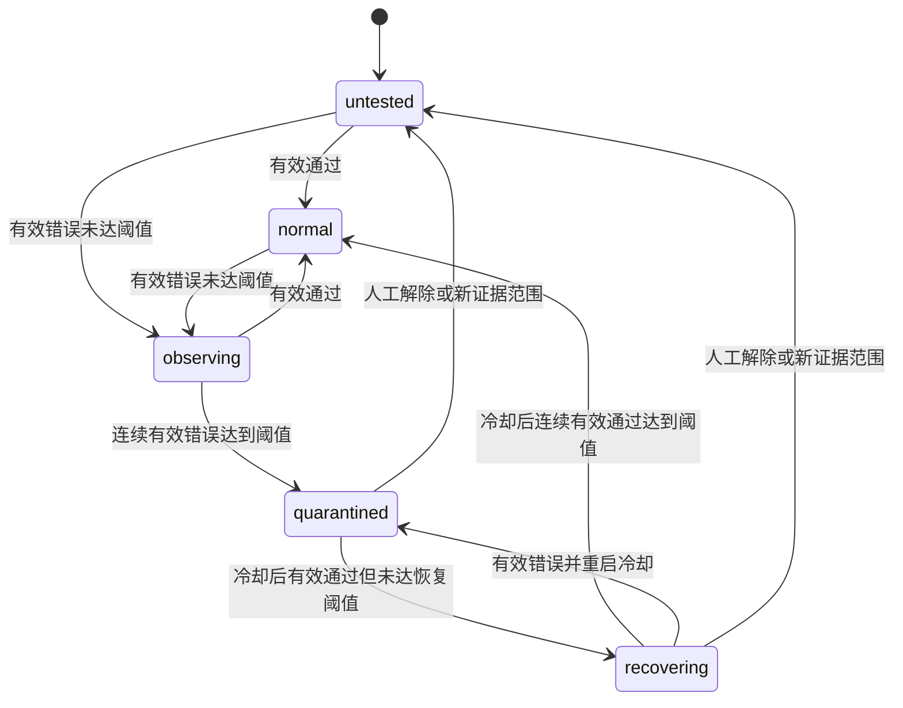

# 整体需求说明书

版本：v1.3；日期：2026-10-28；状态：实现需求基线。本文定义所需行为；本地代码已部分接通，不能据此推断已部署或已启用。实际实现与验证状态见 [verification.md](./verification.md#11-本地实现与验证-2026-10-28)。

## 1. 背景与问题

sub2api 已有账号连通性测试、定时测试、OpenAI 健康调度、渠道监控以及鹈鹕生成预览。这些能力能判断请求是否成功、速度和部分生成格式，尚不能形成独立的“回答质量检测 → 调度控制 → 复测恢复”闭环。

需要解决：某账号 HTTP 成功、延迟也正常，但在指定逻辑任务上持续答错时，系统仍可能因为价格、速度或会话绑定而继续分配请求。

参考站点：[manxue.ai](https://manxue.ai/)；[公开 API](https://manxue.ai/api)；相关开源项目 [manxue-ai](https://github.com/w1196396546/manxue-ai)。公开代码与现站存在差异，尤其现站源码分类器未确认可直接取得。

本轮用户要求将开源已有代码搬入并复用，已固定版本导入 third_party/manxue-ai，并移植首个前端监控数据模块；来源和真实接入状态见 [source-reuse.md](./source-reuse.md)。以下完整业务需求仍是拟实施能力，不能将源码引入当作整体功能完成。

## 2. 目标、成功标准与范围

### 2.1 已确认

- 逐账号检测参与 OpenAI“自动不降智分组”的 OpenAI / Codex 上游账号；仅在该模式执行本需求的质量调度控制。
- 根据检测结果降低有效调度优先级、连续错误后隔离、复测通过后恢复。
- 先形成整体需求设计，再评审实现范围。

### 2.2 首期建议交付

| 编号 | 能力 | 首期范围 |
| --- | --- | --- |
| Q01 | 策略管理 | 按账号、模型和检测条件配置；批量创建、编辑、暂停、归档 |
| Q02 | 检测执行 | 手动、定时、隔离恢复三类触发，定向请求现有账号 |
| Q03 | 题目与判分 | 内置版本化糖果题与严格最终答案判分 |
| Q04 | 状态流转 | 未检测、正常、观察、隔离、恢复中；新鲜度独立展示 |
| Q05 | 调度降权 | 保留管理员 Priority；基础合格池优先、观察池后备 |
| Q06 | 隔离与恢复 | 匹配条件隔离、最短冷却、专用复测、人工解除 |
| Q07 | 管理界面 | 独立检测监控页、独立检测配置页、账号摘要、批量配置/检测、详情、历史和控制预览 |
| Q08 | 费用与容量 | 调用次数、Token、预算、限并发和探测低优先级 |
| Q09 | 一致性 | 幂等、任务互斥、租约、终态事务、策略版本防覆盖 |
| Q10 | 权限与审计 | 现有管理员访问，普通用户/受限管理密钥拒绝，敏感字段脱敏 |
| Q11 | 异常与回退 | 存储异常、检测异常、无合格账号、紧急关闭、旧版回退 |
| Q12 | 验收与观测 | 检测指标、状态事件、调度原因及跨路径回归 |

### 2.3 本期范围之外

- 模型身份鉴定、保证某模型一定“满血”、统一综合智商分数。
- 把其他站点的公共通过率直接应用到本站账号。
- 将上游账号 Key 或 OAuth Token 提交给第三方检测站。
- 获得未知分类器前复刻 manxue.ai 最新鹈鹕判分；“完整 HTML”不算视觉合格。
- Claude、Gemini、Grok 等平台的自动控制，用户端公开质量排名。
- 自动改价格、倍率、分组归属、账号原始优先级、管理员禁用状态。
- 执行生产迁移、部署或真实账号批量检测。这些属于实现后独立操作。
- 普通固定分组、直接指定普通分组、独立 composite 路由，以及其他平台的新增质量检测/控制。

### 2.4 成功标准

管理员可以从配置、运行、解释结果，到看到真实调度生效和恢复，完整追踪每一步。全部控制关闭时，现有选路、计费、测试和生成预览的行为保持兼容。质量控制开启时不存在已知选号旁路；有绑定关系的会话失败要明确告知，不能偷换账号。

### 2.5 用户指定的分组边界（本版新增）

“不降智分组”指项目已经存在的**自动不降智分组**，前端选项值为 `openai_auto_cheapest`，后端通过 `APIKey.UsesOpenAIAutoCheapestGroup()` 判断。它是跨来源的自动调度模式，不是以名称包含“不降智”判断的普通 groups 行；不新增一个同名业务分组。

- 检测库存来自活跃、允许自动调度的 OpenAI 普通来源分组及其实际引用的自建号池，逐账号、逐有效条件配置，不扫描全部 OpenAI 账号。
- 手动、定时、恢复三类检测都必须校验账号仍属于该库存；仅在普通固定组可用的账号不允许为本需求新建或执行策略。停止参与后暂停任务/控制并保留历史，重新加入须建立新证据。
- 普通来源组的管理库存不等于某用户的候选授权；真实请求仍由现有 CandidateGroups 校验用户可用组、密钥最高倍率等，检测结果不能扩展权限。
- 真实控制只作用于原始 API Key 处于自动不降智模式的请求。该请求内部切换实际分组、共享自建池或重试时仍属于本范围；不能因 effective GroupID 改变丢掉标记。
- **同一账号同时服务自动不降智和普通固定分组时，质量隔离仅在自动不降智模式生效。** 不写账号全局错误/禁用字段，不影响固定组正常使用。
- 来源分组只用于确定参与资格、探测上下文与展示；相同账号/有效条件去重，检测次数不按用户数、密钥数或挂载分组数重复增加。

上述业务边界为用户本轮明确要求；题目、阈值和其余 D01–D09 建议仍待评审。

## 3. 术语与对象

| 术语 | 定义 |
| --- | --- |
| 逻辑账号 | accounts 中的账号 ID，包括借用母账号凭据的影子账号 |
| 检测配置 | 精确模型、协议、effort、服务档位、题目/评分版本等输入条件 |
| 证据范围 | 某逻辑账号、有效路由与检测配置对应的一组可比较结果 |
| 策略 | 证据范围加执行周期、失败阈值、恢复阈值与控制开关 |
| 检测记录 | 一次独立任务的输入快照、运行状态、作答结果及用量 |
| 有效作答 | 成功完成且能解析出唯一最终答案，结果为 passed 或 incorrect |
| 质量状态 | 对有效作答累积形成的状态，独立于账号可用性 |
| 控制匹配 | 请求模型与有效检测条件满足策略范围，才可应用降权/隔离 |
| 观察模式 | 保存和展示质量状态，记录预计影响，不改变真实请求选路 |
| 人工解除 | 管理员解除质量限制并重建计数；不是证明模型恢复 |

逻辑账号与实际凭据所有者分别记录。母账号与影子账号、两个别名模型之间不自动传播结果，避免把不同路由、权限或 Prompt 条件混为一谈。

同一逻辑账号的同一规范化请求范围首期仅允许一个活动策略；换题/换评分版本需显式替换并重建证据，不能让两个策略对同一请求同时下相反结论。检测条件保存后不直接改写，使用原子“归档旧策略 + 新建替代策略”；只改周期、阈值或开关可编辑原策略。

## 4. 角色、入口与权限

项目当前使用 `IsAdmin()` 判断管理员；受限管理 API Key 按动作目录授权，未登记动作默认拒绝。

首期由现有管理员角色使用所有质量能力。普通用户和受限管理 API Key 均不能配置、读取、触发、取消或解除隔离。不新增名为“超级管理员”的角色。现有后台登录及审计机制继续复用。

后台新增“OpenAI 质量检测”导航，含“检测监控”和“检测配置”两个独立页面；账号管理保留质量摘要、批量快捷入口和详情抽屉。系统设置只提供跳转，不维护另一份重复配置。均只向现有管理员开放。页面布局见 [ui-design.md](./ui-design.md)。

## 5. 开关与配置原则

设置分两层，手动执行独立于自动执行：

| 层级 | 配置 | 默认与行为 |
| --- | --- | --- |
| 全局 | 自动检测总开关 | 关闭；关闭后不创建定时/恢复任务 |
| 全局 | 调度控制总开关 | 关闭；关闭后质量不影响选路 |
| 策略 | 自动检测 | 关闭；需全局与策略同时开启才运行 |
| 策略 | 调度控制 | 关闭；需全局与策略同时开启才影响匹配请求 |
| 策略 | 归档 | 归档时停止自动/控制，新手动任务拒绝，历史保留 |

“暂停自动检测”不等于“解除隔离”。如果控制仍开启，隔离保留且页面提示无法自动恢复。提供“紧急停用质量功能”，原子关闭两个全局开关；在缓存同步期限内退出质量控制，不改动其他账号限制。

单纯打开控制开关不得追溯隔离旧数据：每个策略设置新的控制开始时间，隔离证据从该时间之后开始累计。此前历史仍展示。关闭控制后的旧控制状态不在再次开启时突然恢复。

### 5.1 默认值、硬上限与保存边界

- 创建策略时，将代码内置的规则默认值以及当前全局 `default_policy_daily_call_limit` 复制为该策略的实际值。以后修改默认日预算只影响新策略，不覆盖已有策略；不增加隐式继承链或第三张配置页面。
- 全局并发、队列和每日预算是所有任务共用的硬约束；策略预算是额外约束。一个策略额度再多，也不能越过全局额度。
- 全局设置和每个策略分别保存、分别校验 revision。批量更新必须逐项提供完整目标规则和 revision，全部成功或全部失败；不提供隐式“应用到所有账号”。
- 范围/条件变更走显式替换；来源资格变化或外部路由漂移由服务端使旧证据失效。具体操作生效表见 [集成指南 §3](./implementation-guide.md#3-配置变更的生效规则)。

### 5.2 编辑与任务的关系

关闭自动开关停止产生定时/恢复任务，并取消尚未出站的这两类任务；合法手动任务仍可运行。任何策略规则编辑都推进revision并取消旧revision未出站任务（包括旧手动任务），可以重新提交使用新配置的手动任务；单独关闭全局自动不改策略revision。已经出站的调用允许有界完成，不能撤销费用；只有revision、范围、代次、租约仍匹配时才能参与当前状态。关闭自动不推进控制代次，因此不自动解除隔离。

普通周期变更重新计算下一次到期时间，不补发错过的周期。阈值变更不在保存时重判历史，下一有效作答使用新规则；当前已承诺的 `cooldown_until` 不缩短或延长，新的冷却参数用于下一次进入隔离。新证据窗口立即用于新鲜度判断，状态归约在下一有效样本时执行，已隔离不因缩短窗口解除。

降低并发不终止正在调用的任务；降低队列上限不清空既有队列。降低预算时，未出站任务必须按新额度重新校验，无法继续的预留释放并记 skipped；已发出的不退款。缩短保留期从后续清理批次生效，已清理正文不能通过调大保留期恢复。

## 6. 检测条件与有效范围

### 6.1 支持对象

- 平台为 OpenAI，走项目已有 API Key 或 Codex OAuth 定向调用路径。
- 模型必须是该账号支持的文本推理/生成模型；模型映射按账号实际规则解析。
- Agent Identity、影子凭据等仅在现有定向调用能力完整支持时接入；不支持时明确标记 unsupported，不退化为其他账号或普通 `hi` 测试。
- 不为所有账号静默生成策略，不对新增账号自动开启检测。
- 本节支持对象还须满足 §2.5 的自动不降智参与资格；平台为 OpenAI 本身不构成检测资格。

### 6.2 精确匹配（首期建议）

记录：账号、公开/请求模型、映射后的实际模型、上游协议和端点、HTTP/WS 传输类别、有效 effort、有效服务档位、路由指纹、题目版本、评分器版本。

- `gpt-6-astra` 的结果不直接作用到 `gpt-6.1-sol`。
- low 的结果不直接作用到 high；priority 的结果不作用到未指定档位。
- 客户端未指定 effort/tier 时，按系统实际会发往上游的有效值匹配；供应商默认未知时保留 `upstream_default`，不能擅自认为是 low 或 standard。
- 使用项目现有的上游模型与 effort 映射后再比较，不能只比较客户端原始字符串。
- 只有 HTTP Responses 证据时，不自动声称测过 WebSocket 或原生 Chat Completions。相同有效上游路由的入站兼容接口可共享；真正不同的协议/传输需要独立策略，或维持观察、不参与该范围控制。
- 路由、凭据身份、模型映射改变后，旧证据标记已失效，立即安排新检测；不得把旧隔离直接套在新身份上。

**待评审选项**：是否允许“使用 low 参考测试，控制该账号此模型的所有 effort/档位/传输”。此方式覆盖更广，但属于证据推广，应显式配置、标明推断来源；首期建议关闭。

## 7. 检测题与判分需求

### 7.1 首期内置 candy-v1

糖果数量如下：

| 形状 | 苹果味 | 桃子味 | 西瓜味 |
| --- | --- | --- | --- |
| 圆形 | 7 | 9 | 8 |
| 五角星 | 7 | 6 | 4 |

题目必须明确：可以凭手感选择形状，活动前固定圆形和五角星各取多少，不能识别口味，也不能根据已取口味调整。目标是保证出现“圆苹果 + 星桃子”或“圆桃子 + 星苹果”中的至少一对。

服务器期望的最小总数为 **21**，一个保证方案为圆形 9、五角星 12。若不允许控制形状，则保证数是 29，属于另一道题。2026-10-28 已枚举 201,600 种数量分配独立核对，不能混用这两个前提。

本系统题目补充了确定性前提和最终答案输出约束，因此不是声称与参考站 Prompt 完全一致。题目/评分器版本均写入每条记录。

### 7.2 最终答案格式

请求要求输出一个最终 JSON：`{"answer":21}`。推理过程由支持推理的模型自行完成，不要求输出思维链。是否披露推理过程不参与评分。

判分器只接受完整 JSON 对象，或仅被一个 `json`/无语言代码围栏包住的完整对象。必须只有一个不重复的 `answer` 键，值为 JSON 整数。允许空白，不接受字符串 `"21"`、小数、重复键、多份候选 JSON 或正文中的任意数字匹配。

首期整数范围为有符号 64 位；小数/指数表示、溢出都记 unknown: invalid_answer_format，不能在类型转换时变成 21。仅使用上游最终正文，不把推理摘要、工具调用参数或响应元数据拼进最终答案。

| 返回情况 | 作答结果 | 是否累计质量证据 |
| --- | --- | --- |
| 唯一合法整数 answer=21 | passed | 是 |
| 唯一合法整数 answer≠21 | incorrect | 是 |
| 解释中提到 21，但唯一最终 JSON 的 answer≠21 | 不接受混合正文为合法格式，记 unknown；绝不通过 | 否 |
| 格式异常、空输出、截断、响应未完成、拒绝回答 | unknown，并细分原因 | 否 |
| 不支持 effort/tier/协议或检测功能 | unknown: unsupported | 否 |
| 认证、限流、超时、5xx、传输失败 | error，并细分原因 | 否 |

unknown 连续过多必须显示“检测覆盖不足”，不能保持绿色正常，也不能直接判成降智。若以后放宽解析规则，必须使用新评分器版本重新建立证据。

### 7.3 后续题库与鹈鹕能力

题库按模板和版本扩展；允许服务器独立计算参考答案的参数化题，但同一策略只有一个证据版本。管理员自填任意 Prompt 仅做诊断，不自动进入控制。未来引入鹈鹕分类器须固定模型/权重版本、验证误判与来源，再另行决定是否参与自动控制。

### 7.4 首期固定题面与效果校准

拟内置的中文题面如下，正式落地时以字节级版本及内容摘要固定，不按每次调用临时改写：

```text
袋中有两种形状、三种口味的糖果：
圆形：苹果味7颗、桃子味9颗、西瓜味8颗。
五角星：苹果味7颗、桃子味6颗、西瓜味4颗。
你能凭手感选择形状，但无法识别口味。你必须事先固定取多少颗圆形、
多少颗五角星，不能根据抽出的口味调整；同一形状内可能取到任意组合。
至少取多少颗，才能在最不利情况下仍保证取到以下至少一种搭配：
一颗圆形苹果味与一颗五角星桃子味，或一颗圆形桃子味与一颗五角星苹果味？
只输出一个JSON对象，唯一字段answer的值为最小总颗数的整数，不输出其他正文。
```

正确答案由服务器独立保存，不作为提示发送给模型。不使用“你是否满血”等自我声明，也不要求输出推理链。

单题只衡量该条件下完成此类任务的表现，不能证明模型身份或全部业务质量。重复错误可能相关，不能套用独立概率声称“连续三错误判率极低”。上线前先以只观察方式，在实际目标账号/条件下采样，记录有效判分率、答案分布、unknown 原因和实际 Token，人工核对隔离候选；覆盖不足或单题记忆明显时保持停控并调整题库版本。真实采样会消耗额度，属于后续单独授权；本轮不执行。

## 8. 执行与任务规则

### 8.1 三类触发

1. **手动**：在选定策略上立即创建任务；页面关闭不取消已提交任务。隔离冷却期内手动运行可诊断，但不能绕过最短冷却恢复。
2. **定时**：全局与策略自动开关都开启，按固定间隔加抖动执行；首期不新增复杂 Cron 编辑器。
3. **恢复**：仍处于质量隔离且冷却到期时，由独立低频恢复任务执行。不能因真实选号已过滤该账号而永远无法复测。

### 8.2 资源约束

- 系统内直接指定 account_id，不经自己的公网 API Key 再随机选号。
- 同一个逻辑账号最多一个质量任务在调用上游；同一策略不得重叠。
- 集群质量调用并发上限默认 3；批量选择最多 100 个策略；等待队列上限 300，超时排队任务标为 skipped。
- 共享真实账号的可用并发容量，优先服务真实用户；繁忙时延后探测，不抢占正在运行的真实请求。
- 单次上游超时默认 180 秒；整次排队最长 5 分钟。到期顺延一次，不因错过多个周期补发历史任务。
- 无法确定上游是否已受理时，不自动重发同一付费请求；后续周期是新任务。
- 取消、服务重启、过期租约、预算不足、账号过期等不算答案错误。
- 冷却后的复测因配额/限流受阻时显示受阻原因，不清除原隔离。

## 9. 质量状态与有效证据

运行状态、作答结果、质量状态和新鲜度是四个独立维度，不用一个 status 混装。

| 质量状态 | 页面名 | 含义 | 开启控制后 |
| --- | --- | --- | --- |
| untested | 未检测 | 没有当前证据范围的有效样本，或人工重置 | 基础调度 |
| normal | 正常 | 最近有效作答通过且在有效期内 | 基础调度 |
| observing | 观察 | 有效作答错误，但未到隔离阈值 | 调度后备池 |
| quarantined | 已隔离 | 达到有效错误阈值 | 拒绝匹配请求 |
| recovering | 恢复中 | 冷却结束后已有通过，但未到恢复阈值 | 继续拒绝匹配请求 |

新鲜度显示 fresh/stale/never；不伪装成额外的质量证明。normal 过期显示质量未知；observing 过期取消软降权并提示重新检测。quarantined/recovering 不因时间过期自动解除。

### 9.1 推荐状态规则

- 非隔离状态 passed：清零连续错误，置 normal。
- 非隔离状态 incorrect：在有效窗口内加一；小于 3 置 observing，达到 3 置 quarantined。
- 连续错误仅统计最近 120 分钟内、同证据范围、同控制周期、最近一次相反有效答案之后的有效作答；unknown/error 既不加错也不加对。逐个剔除窗外样本，不能只检查最近两次的间隔而无限累加。
- 进入隔离设置最早复测时间=进入时间+30 分钟，恢复通过数归零。
- 冷却未到期：有效结果只记录诊断，不解除隔离、不积累恢复通过数。
- 冷却后 passed：恢复计数加一，第一次置 recovering；第二次通过置 normal，解除质量隔离。
- 恢复期间 incorrect：恢复计数归零，重新进入 30 分钟最短冷却。
- 恢复期间 unknown/error：保持质量限制，恢复样本仍受 120 分钟窗口约束。
- 人工解除：必须填写原因，状态置 untested，清零计数、增加状态代次、保留历史并显示“人工解除”，不显示“复测正常”。

这些状态在仅观察时也可以形成，但页面必须写“仅观察，未影响调度”。启控建立新代次后状态从 untested 开始，旧隔离结论保留历史，不会突然成为新限制。配置规则修改不在保存时回放历史改变状态，下一次有效样本按新规则处理。



阈值可配为 1，因此实现需支持 untested/normal 一次 incorrect 直接隔离、冷却后一次 passed 直接恢复；图中展示默认阈值路径。

## 10. 调度控制需求

### 10.1 不改变其他硬门槛

原有管理员禁用、schedulable=false、过期、额度、模型权限、协议能力、隐私、上游渠道限制及利润控制仍先成立。质量通过不能使原本不可用的账号变成可用。

### 10.2 降权定义

不改写账号/分组原始 Priority。对基础合格候选分两池：

- 基准池：正常、未检测或没有新鲜软惩罚证据的账号，按原调度规则排序。
- 观察池：有新鲜 observing 证据的账号，仅在同一调度阶段基准池无可选账号时使用，池内保留原有速度/价格/优先级规则。

这是自动不降智模式内的有效选号优先级降低，不承诺固定减少某个百分比的流量；已有会话绑定另见下节。固定组请求在进入这些质量分池前退出，沿用原逻辑。

### 10.3 隔离范围与分组

同一账号挂在多个来源时，**自动不降智请求内部**的精确范围隔离跨来源成立，不能换来源绕过；普通固定组和独立 composite 请求不受本需求质量状态影响。

当前代码的自动不降智已采用“遍历全部来源寻找现有健康达标账号，再做宽松可用性兜底”，不能恢复为“便宜组观察账号先于较贵组达标账号”的旧策略。建议顺序：先保持现有 qualifiedOnly/严格故障切换阶段；每个阶段先扫描所有来源的基准质量池，再扫描观察池；来源内部仍按现有失败来源后置、池优先、倍率、渠道价格和账号排序规则执行。Legacy 无严格健康阶段时保留其兼容行为，但在自动模式内同样先基准、后观察。

共享自建池、备用来源只在其被自动不降智请求实际引用时执行本质量门。真实分组授权、最高倍率和模型限制不变；不能借质量恢复名义改走未授权来源。质量排除原因独立记录，不冒充上游故障去增加原有账号/组熔断计数。

### 10.4 会话与传输

| 路径 | 观察状态 | 隔离状态 |
| --- | --- | --- |
| 自动不降智新会话/无绑定请求 | 优先基准池 | 排除 |
| 普通固定组/独立 composite 请求 | 沿用原逻辑 | 不应用本质量隔离 |
| 可安全迁移的 session | 优先迁移到同范围基准候选 | 重选并按既有规则重建绑定 |
| 不可迁移的 previous_response_id | 维持绑定，记录降权未执行原因 | 明确返回重新建立会话提示；不把原 ID 交给其他账号 |
| WebSocket 后续 turn | 每 turn 判断；不可安全迁移则维持并注明 | 在发送该 turn 上游前拒绝，不自动截断已开始的 turn |
| 已有输出或上游已执行的请求 | 不追溯重选 | 不拼接其他账号输出；隔离影响后续请求 |
| 账号管理的专用检测 | 不受质量池阻止 | 仍允许诊断/恢复，不解除其他账号限制 |

首期若某种传输尚无同条件证据或无法在其准入处执行质量门，该范围只能观察，界面不得允许开启虚假的“已控制”。

### 10.5 无候选与存储故障

- 全部匹配候选被质量隔离：返回 503，原因 `QUALITY_NO_ELIGIBLE_ACCOUNTS`；不静默放行隔离账号。
- 只有观察账号：允许后备使用，不形成可用性死锁。
- 质量数据存储故障：优先使用有版本的最近有效快照；已知隔离不因读失败被清空。
- 无可信快照：**建议对已开启质量控制的调度范围返回 `QUALITY_STATE_UNAVAILABLE`**，不把数据源故障说成降智。管理员可用紧急开关明确退出控制。
- 上一版草案曾建议未知数据直接走基础调度；本稿改为以上保守建议，以避免重启后绕过隔离。此取舍列为待评审项，不代表已获用户确认。

紧急开关依赖设置成功保存及跨实例同步。数据库不可写时，页面可能无法关闭，必须显示失败；不能只改某个进程内存后声称系统已停控。重启时无法读取设置也不能当成默认关闭，运维需恢复依赖或按已批准的停控/回退流程处理。

## 11. 页面与交互设计

### 11.1 两个独立页面

新增后台“OpenAI 质量检测”菜单：

| 页面 | 拟议前端路由 | 内容 |
| --- | --- | --- |
| 检测监控 | /admin/openai-quality | 状态概览、自动不降智参与账号、来源组/模型筛选、任务与历史、详情和解除/复测操作 |
| 检测配置 | /admin/openai-quality/settings | 全局设置、检测策略配置、来源库存与能力、预算预览、保存和启停 |

两个页面顶部固定显示“仅作用于自动不降智分组”。监控页可跳转到某策略的配置区；配置页可跳转到相关历史，不把全部表单塞进账号列表。

页面复用开源版已经存在的统计卡、24H 色块时间线、图例、检测频率/下次时间、历史下钻和节点配置组织，适配为本站内部账号/策略。保留结果详情与用量展示；公开画廊、访客凭据输入和独立密码登录不接入。时间线按策略/证据范围隔离，原版统计分母改为本需求定义的有效答案分母。

监控概览和单策略 24 小时图使用独立服务端聚合接口，不从一页历史推算全量指标。默认只展示当前范围/控制代次，可切换到“当前范围全部代次历史”，切换后不得把旧观察样本解释成当前隔离证据。聚合返回服务端时间、统计范围、完整性和代次；存储故障显示不可用，不能用零或空白图冒充无异常。详情见 [API §11](./api-contract.md#11-监控聚合与时间线契约)。

配置页的全局区展示自动检测/调度控制总开关、并发/预算/保留设置、任务与存储健康、最后同步时间；策略区配置模型、effort/tier、题目、周期、失败/恢复阈值与冷却。启控前区分历史观察风险与新代次实际影响，首次启动需积累新证据。详细线框与交互见 ui-design.md。

### 11.2 账号列表

增加可选“质量检测”列：策略数、最严重状态、匹配模型/条件和最近检测时间。多策略混合状态不能只给账号打一个“正常”标签。筛选支持未配置/正常/观察/隔离/恢复中/证据过期；状态旁明确“仅观察”或“控制生效”。

未参与自动不降智的账号显示“不在检测范围”；其新建/运行按钮禁用。参与账号的质量标签注明“仅自动不降智生效”，不能让管理员误以为账号在所有分组被封禁。普通分组管理页只保留现有参与自动调度开关，可链接监控页，不新增普通分组启控入口。

### 11.3 批量配置与执行

```text
检测配置页（或账号快捷入口）→ 选中范围内账号 → 配置策略
  生效模式：自动不降智分组（只读）
  目标账号：可展开核对；不在自动不降智库存或不支持文本路由的账号标明原因
  检测条件：模型、协议/传输、effort、服务档位、题目与评分版本
  执行：手动 / 自动周期；失败阈值、样本窗口、冷却、恢复规则
  控制：仅观察（默认） / 对匹配条件生效
  提交前：显示总策略数、预算上限、预计每日调用次数
  操作：保存策略 / 保存并检测
```

批量配置校验全部通过才提交，防止只修改部分账号的控制规则。批量运行允许逐项返回“已排队/已有任务/跳过及原因”，不把跳过项算成成功。

### 11.4 质量详情抽屉

顶部：账号/模型/有效条件、质量状态、证据新鲜度、控制生效范围。中部页签：最近结果、历史、策略、调度影响、审计。

结果详情展示：运行状态与作答结果、最终答案/期望答案、判分原因、原始回答、耗时、Token、是否参与状态累计及未参与原因。历史列表默认不返回完整正文，点击详情再取；文本安全转义，不执行生成代码。

操作：立即检测、冷却到期复测、取消任务、暂停自动、关闭该策略控制、人工解除、归档。每个操作说明是否仍消耗额度以及是否立即影响真实请求，尤其区分“停测”和“停控”。

## 12. 配置字典与建议默认值

下表全部为拟新增配置，使用现有 settings/管理表单机制承载，不声称项目已存在这些字段。

| 配置 | 推荐默认 | 校验范围/规则 |
| --- | --- | --- |
| 普通检测间隔 | 1,800 秒 | 300–86,400 秒 |
| 抖动 | 60 秒 | 0–min(300, 间隔/4) 秒 |
| 连续错误阈值 | 3 | 1–10 |
| 连续恢复阈值 | 2 | 1–10 |
| 最短冷却 | 1,800 秒 | 300–86,400 秒 |
| 恢复检测间隔 | 600 秒 | 300–86,400 秒 |
| 证据窗口/有效期 | 7,200 秒 | 600–604,800 秒；至少覆盖两类间隔和各自阈值的理想样本跨度，见下文 |
| 单次上游超时 | 180 秒 | 30–600 秒 |
| 输出上限 | 4,096 tokens | 512–16,384，按供应商能力校验；不支持时显示不可形成硬上限 |
| 集群并发/账号并发 | 3 / 1 | 集群 1–10，账号固定 1 |
| 单次批量/全局排队上限 | 100 / 300 | 批量 1–100；队列 100–1,000 |
| 排队最长时间 | 300 秒 | 60–1,800 秒 |
| 单策略每日调用上限 | 100 | 1–1,000；定时、手动、恢复共用 |
| 全局每日调用上限 | 1,000 | 1–100,000；按实例配置时区自然日计算 |
| 完整正文保留 | 7 天 | 1–30 天；单次最大 64 KiB，超长记 unknown |
| 结果元数据/事件保留 | 30 天 | 7–180 天 |
| 状态/设置缓存同步目标 | 5 秒 | 正常依赖环境下的设计目标，需压测 |
| 正常历史快照故障宽限 | 60 秒 | 宽限后无法刷新返回状态不可用；已知隔离不自动过期 |

计费 Token 可能包含不可直接限制的推理开销；上游不支持输出硬上限时不能承诺单次绝对费用上限，页面必须显示此限制。

令普通间隔为 I、恢复间隔为 R、失败阈值为 F、恢复阈值为 P、窗口为 W。保存必须满足 `W >= max(I, R, (F-1)*I, (P-1)*R)`；例如 F=10、I=30 分钟而 W=120 分钟必须拒绝。阈值为 1 也仍满足最小窗口与间隔约束。

该校验只证明理想情况下样本可装入窗口，不能保证预算、抖动、队列、上游耗时和 unknown/error 下仍可达到。预览另展示窗口余量、理论调用量、预算覆盖和采样不足警告；不得自动放宽窗口、降低阈值或提高预算。

## 13. 费用、预算与用量

每日基础调用数约为“自动策略数 × 86,400 / 检测间隔”，另加手动和恢复任务。例如 100 个策略、每 30 分钟一次，基础为 4,800 次/天，高于建议全局 1,000 次默认限额，必须在配置预览中提示并由管理员调整。不能静默无限检测。

这组配置的全局预算只覆盖约 20.83% 基础调用。若公平均摊，每策略约 10 次/天、平均 144 分钟一次，超过默认 120 分钟窗口，连续有效样本可能无法稳定累计，故“定时已开启”不能显示成“检测覆盖充分”。预算不足为可保存的警告，硬性窗口/范围/能力错误则拒绝保存；页面提示可减少策略数、调整周期/窗口或由管理员显式调整预算。

18 个策略每 30 分钟的理论基础量为 864 次/天，距离 1,000 次上限余 136 次，可作为小规模容量示例。余量不是恢复专用预留，手动、异常、恢复仍共用，不能据此保证恢复时刻或真实费用。容量算法和示例见 [集成指南 §4](./implementation-guide.md#4-预算与证据窗口的容量预览)。

先在事务内预留当天调用名额，再发上游；未发出的取消/跳过可释放名额，已发出或受理情况不确定的不退回调用名额。Token 缺失保存 null，不能填 0；费用估算沿用项目定价能力，并标明估算价、缓存和优惠的局限。

检测为运营成本，不创建普通用户 usage_logs、不扣某个用户/API Key 余额。需要独立记录检测用量；真实上游额度仍然会消耗。检测中的网络错误也不能伪装成真实业务成功或延迟样本。

## 14. 异常与运维场景

| 场景 | 要求 |
| --- | --- |
| 账号停用、过期、额度/限流阻止调用 | 自动任务跳过或延后，人工任务返回明确原因，不清除质量隔离 |
| 账号删除 | 停止关联策略，进行中调用协作取消；保留脱敏检测与事件快照 |
| 模型映射/代理/上游地址改变 | 路由指纹失效，重新建立证据；不继承旧隔离到新范围 |
| Token 正常刷新 | 同一身份无需抹掉历史；身份改变才失效，不保存 Token 哈希当身份 |
| 任务超时、取消、服务重启 | 保存 error/cancelled/interrupted，不能记 incorrect |
| 重复点击/断网重试 | 同幂等键返回原任务，冲突请求体返回 409 |
| 旧任务晚到 | 记录保留，版本/租约/状态代次不符则不更新当前状态 |
| 数据库写失败 | 不发布成功或恢复快照，显示持久化失败；不得用内存恢复结果放行 |
| Redis/进程缓存失效 | 有界批量回源；失败按存储故障策略处理 |
| 多实例故障切换 | 独占任务认领、额度预留、终态 fencing；不宣称上游调用 exactly-once |
| 所有策略预算用尽 | 停止新调用并提示；不会把暂停检测当作恢复 |
| 实例时钟偏差 | 租约、冷却、预算日期以数据库时间与配置时区为准 |

## 15. 观测、审计与通知

- 指标：各作答结果计数、有效判分率、过期证据比例、检测延迟、队列长度、预算消耗、租约失效、保存失败、缓存回源、隔离/恢复数量和质量拒绝请求。
- 通过率=`passed/(passed+incorrect)`；无有效样本显示“暂无有效结果”。同时展示有效样本/全部任务，避免 3 次通过、1 次错误、56 次异常被解释成系统 75% 可用。
- 状态变更事件记录旧/新状态、原因、证据 run_id、操作人、控制周期和发生时间；配置变更与人工解除可追踪。
- 调度决策记录质量是否匹配、实际执行还是仅观察、拒绝/后备原因；不记录密钥或完整用户业务请求。
- 首期提供站内状态与事件，不新增 Slack/邮件/Telegram 等外部发送。若复用现有告警，单独确认渠道与阈值，并按账号/条件去重，故障恢复只产生一次事件。

## 16. 非功能要求

功能关闭时不进行质量表读取，不新增业务请求的质量依赖。开启后一次选号共享批量快照，禁止每候选账号各查数据库。

性能验收目标：基于 100 个候选、1,000 个有效策略、并发请求的本地可重复基准，缓存命中增加的选号 P95 ≤5 ms；一次选号批量回源次数 ≤1，回源超时上限建议 100 ms。以上是待测目标，不能作为已验证性能承诺。

所有后台任务可停止并有界排空；结果清理分页执行，不占用选号锁。迁移采用增量、旧表兼容方式；不通过覆盖 accounts.extra 或复用 rate-limit 字段承载新的质量语义。

## 17. 分期、上线与回退

阶段 A：内置题、手动执行、独立记录与页面，仅观察。阶段 B：定时、预算、并发/重启恢复、状态聚合。阶段 C：多路径调度控制与人工/自动恢复。阶段 D：观察结果稳定后，由管理员显式开启少量账号，再扩大。

首期完成标准包括 A–C，不能把只有检测页面视为已完成控制。阶段 D 是运营启用，不包含在本次设计授权内。关闭两个总开关可退出质量功能；历史保留。回退旧应用前确认控制已经停止；旧应用不会识别质量隔离，不能声称旧版仍保持该保护。

## 18. 待评审决策清单

下列项目已有完整推荐规则，用户尚未确认；当前无需先回答才能阅读方案。

| 编号 | 决策 | 推荐 | 可选方向及后果 |
| --- | --- | --- | --- |
| D01 | 首期自动控制证据 | 明确前提的糖果题 | 加入鹈鹕需取得分类器/独立校准，不能以生成完整 HTML 替代 |
| D02 | 控制推广范围 | 精确模型与有效条件 | 模型级全 effort/tier 覆盖更广，但可能误伤未测条件 |
| D03 | 阈值/冷却/恢复 | 3 次错误、最短 30 分钟、2 次恢复 | 可调；阈值低反应快但误伤高，阈值高恢复慢 |
| D04 | 全部隔离 | 拒绝请求并明确原因 | 自动放行隔离账号提高可用性，但削弱控制承诺 |
| D05 | 质量存储故障且无可信快照 | 对开启控制范围拒绝 | fail-open 提高可用性但可能绕过已有隔离，必须显式选择 |
| D06 | 长期不能复测通过 | 保持隔离，提示人工介入 | 设置最大隔离期后自动放行会缺少恢复证据 |
| D07 | 首期权限 | 现有管理员，拒绝受限管理 Key | 开放受限 Key 需新增动作与账号范围校验 |
| D08 | 费用/频率/保留期 | 使用第 12 节建议值 | 根据账号数量、实际 Token 和服务器容量调整 |
| D09 | 真实效果启控门槛 | 先观察目标条件、核对异常分布再小范围启控 | 未校准直接启控可能将题目/格式问题扩大为流量中断 |

下一步先按评审意见更新本稿。用户明确批准实现范围后，才执行 tasks.md 中的业务开发与迁移脚本编写。
